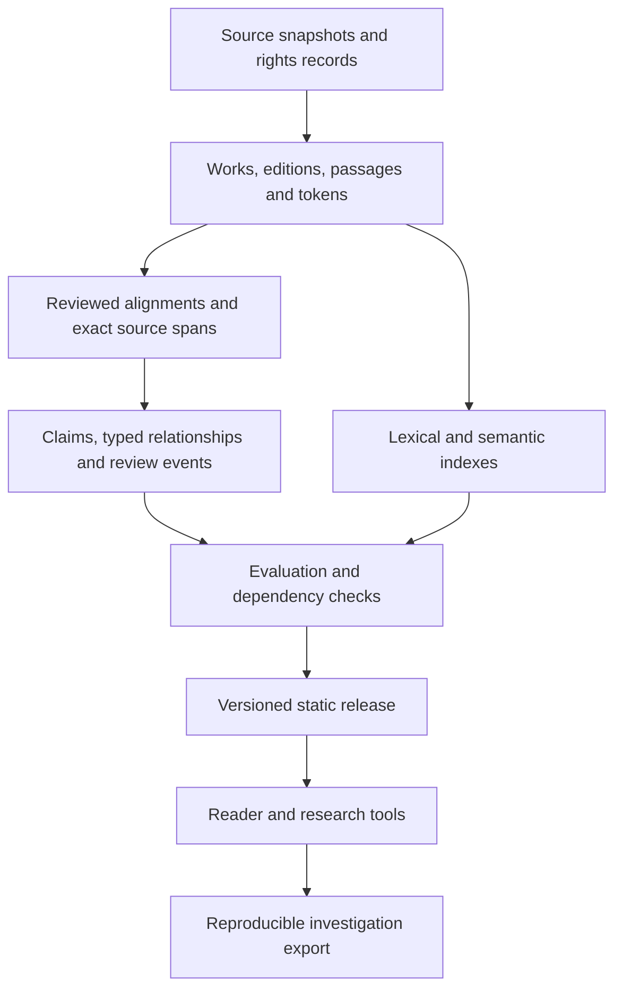

**Scripture research platform: architecture review and development opportunities**

Prepared for Garo Vartabedian · September 5, 2026

Reviewed code revision: `a57f5233e1c131bbb72c8c24a6b474033531a24b`. Source links below point to that revision, so the findings remain checkable after the implementation changes. This is an engineering review of the repository and committed corpus, with selected executable diagnostics and primary-source research. It is not a comprehensive theological, translation, manuscript, legal, or production-performance audit. Recommendations describe proposed work; this review changes only documentation.

**My assessment**

You have built a substantial foundation for the project you described. The strongest work is the combination of readable source material, public data, original-language records, inexpensive delivery, and increasingly explicit provenance. The main constraint is the consistency and quality of the knowledge layer. More powerful models can help greatly, but they will be most valuable when their work is attached to precise sources, evaluated independently, and kept distinguishable from the text itself.

The next substantial advance should be an **inspectable research system**: select a passage or question, discover relationships across texts, examine why each relationship was proposed, compare competing explanations, and reproduce the investigation against a particular corpus release. That would both serve the scriptural purpose and demonstrate valuable engineering to prospective clients.

Your Christian commitment can remain explicit. The system can clearly distinguish your interpretive commitments, what a particular witness says, what an algorithm retrieves, and what an editor concludes. That distinction makes the work more accountable to its purpose.

I cannot substantiate a claim that no one has achieved comparable cross-reference analysis. Sefaria already connects cited and thematically related texts, and STEP exposes biblical cross-references and study resources. The defensible opportunity is a particular combination of transparent evidence, edition-aware analysis, reproducible investigations, and accessible presentation. Its distinction should be demonstrated with working investigations and published evaluations. [Sefaria's related-text workflow](https://help.sefaria.org/hc/en-us/articles/18613227644316-How-to-Find-Interconnected-Texts-in-the-Sefaria-Library), [STEP Bible](https://www.stepbible.org/).

**What exists today**

I recomputed the corpus-health object and confirmed that it exactly matches the committed snapshot. Counts describe hosted data and coverage, not historical completeness or scholarly approval. [Corpus-health snapshot](https://github.com/Vartabg/garovartabedian/blob/a57f5233e1c131bbb72c8c24a6b474033531a24b/public/meta/corpus-health.json).

| Area | Verified state | Assessment |
| --- | --- | --- |
| Application | Next.js 15.5.21, React 19.2.8, TypeScript 5.9.3; Node 24 runtime contract | Appropriate foundation; no framework rewrite justified |
| Hosted scripture | 86 book IDs, five English edition families, five tradition shelves | Substantial coverage; shelves are not complete representations of every canon |
| Source-language data | 83 books, 1,386 chapters, 557,774 word tokens; OSHB, SBLGNT/MorphGNT, selected LXX | Valuable foundation; no general manuscript apparatus |
| Scripture semantic index | 38,029 WEB verses, 1,402 chapter centroids, 81 books, 384 dimensions | Useful retrieval infrastructure; narrower than all hosted scripture |
| Other semantic indexes | 2,059 sayings of Jesus, 614 early-text sections, 54 comparative afterlife records | Reuses one model; heterogeneous source types need explicit treatment |
| Cross-references | 376,117 stored target references; expanded graph has 31,034 nodes and 589,398 distinct directed edges | Real graph computation, primarily over inherited editorial links |
| Contextual material | 1,536 guides; 22 source-backed book briefings | Coverage substantially exceeds uniform editorial quality |
| Current verification | 540 unit tests and 19 smoke tests passed | Strong integrity foundation; passing tests do not establish research accuracy |

The raw reference and graph-edge counts differ because ranges expand into individual verse edges, repeated pairs are consolidated, and invalid endpoints are filtered. The graph records 2,678 discarded invalid edges. These are related measurements, not interchangeable totals. [Graph artifact](https://github.com/Vartabg/garovartabedian/blob/a57f5233e1c131bbb72c8c24a6b474033531a24b/public/scriptures/graph/graph.json), [graph builder](https://github.com/Vartabg/garovartabedian/blob/a57f5233e1c131bbb72c8c24a6b474033531a24b/scripts/site/build-scripture-graph.mjs).

The stack also includes Transformers.js 4.2.0, ONNX/WASM, MapLibre, route-specific CSS, local fonts, Playwright, axe, and Lighthouse. README claims of Next.js 16 and no client dependencies beyond React/Next have drifted from the locked implementation. Its description of chapter rendering is also outdated: the chapter route now provides static parameters and daily revalidation. Correct the documentation before using it as a client-facing technical description. [Dependency lock](https://github.com/Vartabg/garovartabedian/blob/a57f5233e1c131bbb72c8c24a6b474033531a24b/package-lock.json), [chapter route](https://github.com/Vartabg/garovartabedian/blob/a57f5233e1c131bbb72c8c24a6b474033531a24b/src/app/scriptures/%5Btradition%5D/%5Bbook%5D/%5Bchapter%5D/page.tsx).

**Strengths worth preserving**

The core scripture importer stages and validates its outputs before publication. The server JSON layer distinguishes missing optional data from corrupt required data. Chapter pages pass only the viewed chapter across the server/client boundary. Original-language imports retain pinned revisions, morphology, and source references, and restrict unsafe LXX joins. These decisions show care for correctness and delivery cost. [Atomic publication](https://github.com/Vartabg/garovartabedian/blob/a57f5233e1c131bbb72c8c24a6b474033531a24b/scripts/lib/atomic-publication.mjs), [server JSON handling](https://github.com/Vartabg/garovartabedian/blob/a57f5233e1c131bbb72c8c24a6b474033531a24b/src/lib/server-json.ts), [original-language loader](https://github.com/Vartabg/garovartabedian/blob/a57f5233e1c131bbb72c8c24a6b474033531a24b/src/lib/scriptures/server/originals.ts).

Guide provenance distinguishes a model actually called by the pipeline from a model attributed by a reviewer. Human review is separate from agent review. The parallel-text schema already separates composition, manuscript, edition, and translation dates, and defines relationship kinds and review hashes. These are the most promising foundations to extend across the site. [Guide contracts](https://github.com/Vartabg/garovartabedian/blob/a57f5233e1c131bbb72c8c24a6b474033531a24b/src/lib/scriptures/types.ts), [parallel-text contracts](https://github.com/Vartabg/garovartabedian/blob/a57f5233e1c131bbb72c8c24a6b474033531a24b/src/lib/parallels/types.ts).

The chapter-neighbor builder documents an actual rejected experiment: verse-level similarity produced misleading matches, so the shipped feature uses chapter centroids. Preserve that habit of testing attractive ideas against their output. The CI configuration also stages a production artifact and requires independent checks before promotion; this is a code-level observation, not a verification of current account settings or deployed state. [Neighbor builder](https://github.com/Vartabg/garovartabedian/blob/a57f5233e1c131bbb72c8c24a6b474033531a24b/scripts/scriptures/build-neighbors.mjs), [CI workflow](https://github.com/Vartabg/garovartabedian/blob/a57f5233e1c131bbb72c8c24a6b474033531a24b/.github/workflows/ci.yml).

**Findings and recommended changes**

**1. Make passage identity independent of array positions and presentation routes. Priority: high.**

The basic scripture contract is `chapters[chapter - 1][verse - 1]`. Graph nodes use identifiers such as `GEN.1.1`, which omit edition and versification. Original-language storage assigns one edition per book. These are convenient delivery formats, but insufficient as the complete research model when editions split, merge, omit, or renumber passages.

A concrete failure appears in the Catena: the Isaiah 53:5 entry cites 1 Clement 16 and links to `/early/1clement#s16`. The renderer defines `sN` using a zero-based array index. In this work, index 16 is chapter XVII; the intended chapter XVI is index 15. Other works have introductory sections, so subtracting one everywhere would be unsafe. [Catena entry](https://github.com/Vartabg/garovartabedian/blob/a57f5233e1c131bbb72c8c24a6b474033531a24b/src/lib/scriptures/catena.ts#L197), [anchor implementation](https://github.com/Vartabg/garovartabedian/blob/a57f5233e1c131bbb72c8c24a6b474033531a24b/src/app/early/EarlyTextBody.tsx#L50).

Introduce persistent work, edition, passage, and token IDs. Keep display references and route anchors as mappings. Represent cross-edition alignment as a reviewed relationship that can be one-to-one, one-to-many, many-to-many, partial, disputed, or unavailable. Preserve source numbering and subverse labels through import. Existing arrays can remain generated reader payloads.

Acceptance: every cited locator resolves to the intended text; adding a preface does not move citations; known Psalm, Daniel, Esther, and early-text boundaries have independently checked alignment fixtures. The Homer Multitext's citable-text model and TEI's apparatus model provide useful precedents without requiring an immediate XML migration. [HMT text model](https://www.homermultitext.org/editors/hmt-textmodel/), [TEI critical apparatus](https://tei-c.org/release/doc/tei-p5-doc/en/html/TC.html).

**2. Fix silent omissions in cross-corpus retrieval. Priority: high.**

The resonance function computes and sorts Gospel chapter scores but never includes them in its returned horizons. It substitutes the separately indexed sayings of Jesus. A synthetic fixture with a perfectly matching John 11 chapter vector and empty auxiliary corpora returns no hits. This specifically affects resonance; it does not mean Gospel chapters are absent from ordinary scripture semantic search.

The same function classifies only the 66-book Protestant set. Of the 1,402 indexed chapter centroids, **213 chapters in 15 additional books** receive no horizon and disappear from this calculation. The scripture semantic index also lacks five hosted IDs: BEL, ENO, JUB, LJE, and SUS. Some related material appears elsewhere or within differently arranged books; that does not constitute complete edition-aware coverage. [Resonance computation](https://github.com/Vartabg/garovartabedian/blob/a57f5233e1c131bbb72c8c24a6b474033531a24b/src/lib/semantic-resonance.ts#L249), [semantic manifest](https://github.com/Vartabg/garovartabedian/blob/a57f5233e1c131bbb72c8c24a6b474033531a24b/public/scriptures/semantic/manifest.json).

Use an explicit corpus registry for membership, genre, language, source kind, and coverage. Return Gospel narrative as well as sayings, with duplication handled deliberately. Every indexed item should either participate or carry an explicit exclusion reason. Test actual manifests against returned coverage, alongside synthetic ranking math.

**3. Correct embedding input coverage and cache invalidation. Priority: high.**

The early-text builder embeds each complete headed section as one input. The local tokenizer has a 512-token maximum; the installed feature-extraction pipeline enables truncation. I tokenized all 614 sections with that exact local tokenizer: **105 exceed 512 tokens**, and the longest contains 3,627. Consequently, the current build path cannot encode the entirety of those sections in their single vectors. The upstream model card describes a sentence/short-paragraph encoder and a separate 256-word-piece default in Sentence Transformers; that default must not be confused with this repository's 512-token configuration. [Corpus builder](https://github.com/Vartabg/garovartabedian/blob/a57f5233e1c131bbb72c8c24a6b474033531a24b/scripts/site/build-corpus-embeddings.mjs#L85), [local tokenizer configuration](https://github.com/Vartabg/garovartabedian/blob/a57f5233e1c131bbb72c8c24a6b474033531a24b/public/models/Xenova/all-MiniLM-L6-v2/tokenizer_config.json), [model card](https://huggingface.co/sentence-transformers/all-MiniLM-L6-v2).

Use token-aware paragraph/passage chunks with bounded overlap and exact source spans. Rank chunks and aggregate to their parent section, while showing the actual matched passage. Measure late-section retrieval and duplicate-result behavior.

Separately, scripture embedding reuse checks file existence, byte size, and reference count; it does not compare source text, ordered references, tokenizer, or model-content hashes. A wording correction with unchanged verse count can reuse stale embeddings. Builders request a model by name without a pinned revision, and their default model configuration is not explicitly bound to the browser's `q8` configuration. [Embedding cache predicate](https://github.com/Vartabg/garovartabedian/blob/a57f5233e1c131bbb72c8c24a6b474033531a24b/scripts/scriptures/build-embeddings.mjs#L104), [browser embedder](https://github.com/Vartabg/garovartabedian/blob/a57f5233e1c131bbb72c8c24a6b474033531a24b/src/lib/scriptures/semantic.ts).

Bind artifacts to source bytes, ordered passage IDs, preprocessing version, tokenizer and model revisions, pooling, normalization, and quantization. Verify build/browser embedding parity on fixed texts. A same-count source edit must invalidate the appropriate embeddings and all dependent neighbors and summaries.

**4. Raise editorial quality before expanding generated coverage. Priority: high.**

The fresh health calculation reports 1,131 template-classified guides out of 1,536, or 73.6%; 182 pass the current v2 provenance rubric. There are 385 agent-reviewed guides, zero recorded human-reviewed guides, and 1,151 with untracked review status. These categories overlap and should not be summed. Of 9,721 guide questions, 2,576 lack verse references. Only 22 of 86 hosted book IDs have source-backed briefings. The template classifier is a useful triage signal, not a reading of every guide's quality.

Prioritize a coherent set of fully researched books or investigations. Apply v2 grounding, exact-source extraction, claim-level support, explicit uncertainty, and a named editorial review process. Introduce a publication threshold for explanatory content so a superficially complete page does not imply a completed review. Extend the rubric to the actual selected edition; its current exact-WEB checks do not directly solve Charles-only material. Track approved exceptions rather than copying WEB-specific assumptions across the corpus.

The Catena, diachronic comparisons, and disputations are largely authored TypeScript collections with filtering and dossier formatting. They are valuable editorial starting points, but are not general algorithms that discover historical semantic change or adjudicate debates. Their prose and excerpts need the same source and review contracts as the newer guides. [Diachronic implementation](https://github.com/Vartabg/garovartabedian/blob/a57f5233e1c131bbb72c8c24a6b474033531a24b/src/lib/scriptures/diachronic.ts), [disputation implementation](https://github.com/Vartabg/garovartabedian/blob/a57f5233e1c131bbb72c8c24a6b474033531a24b/src/lib/scriptures/disputation.ts).

**5. Promote the parallel-text contracts into a shared evidence model. Priority: high.**

The repository contains much of the right design already: `WitnessLocator`, typed relationships, multiple date kinds, citations, and content-bound review in the parallels subsystem. Elsewhere, cross-references are strings, claim sources are mostly labels/URLs, and the central registry currently contains 50 claims collected from Angels and Apostles. The registry does not yet unify the wider research corpus. [Parallel contracts](https://github.com/Vartabg/garovartabedian/blob/a57f5233e1c131bbb72c8c24a6b474033531a24b/src/lib/parallels/types.ts), [claim collector](https://github.com/Vartabg/garovartabedian/blob/a57f5233e1c131bbb72c8c24a6b474033531a24b/scripts/site/build-claims.mjs).

Keep evidence dimensions independent. A passage can be explicitly quoted, late in date, dependent on another source, disputed in application, and only machine-checked. The current `ClaimBasis` union chooses either textual basis or attestation; the generalized record should accommodate both plus review and dependence. Similarity scores belong in a computation record, not in a historical-confidence field.

Add exact-source selectors to quotations. A `verbatimExcerpt` string, a citation list, and a matching review hash do not prove that the quoted words occur in the cited edition. The parallels validator checks those fields and content hashes but does not itself establish source-span equality. Resolve quoted spans mechanically; record paraphrases and omissions explicitly. [Parallel validator](https://github.com/Vartabg/garovartabedian/blob/a57f5233e1c131bbb72c8c24a6b474033531a24b/scripts/parallels/validate-parallels.mjs).

W3C Web Annotation offers selectors for exact text and positions; PROV provides a vocabulary for data entities, generating activities, and responsible agents. Borrow those concepts and provide export adapters where useful. Full RDF infrastructure is unnecessary for the first implementation. [Web Annotation](https://www.w3.org/TR/annotation-model/), [PROV-O](https://www.w3.org/TR/prov-o/).

**6. Evaluate retrieval as a research instrument. Priority: high.**

Exact search ranks distinct matched tokens, followed by canonical order. It has useful archaic-word fallbacks, but no term-rarity ranking or phrase-position model. Semantic scripture search first takes 48 chapter centroids, then scans at most 14 books. A strong verse in a low-ranking chapter can be excluded before verse scoring. Cross-corpus search combines raw cosine scores across verse snippets, section text, chapter averages, and editorial summaries. Their distributions and evidential meanings are not interchangeable. [Exact search](https://github.com/Vartabg/garovartabedian/blob/a57f5233e1c131bbb72c8c24a6b474033531a24b/src/lib/scriptures/search.ts), [semantic search](https://github.com/Vartabg/garovartabedian/blob/a57f5233e1c131bbb72c8c24a6b474033531a24b/src/lib/scriptures/semantic.ts), [corpus search](https://github.com/Vartabg/garovartabedian/blob/a57f5233e1c131bbb72c8c24a6b474033531a24b/src/lib/semantic-corpus.ts).

Create a reviewed benchmark before selecting a larger embedding model. Start with approximately 100–200 questions covering direct references, quotations, paraphrases, multi-verse arguments, original-language terms, additional-canon material, late-section matches, misleading similarities, and questions the corpus cannot answer. Maintain a held-out set; record disputed relevance judgments rather than forcing consensus.

Compare current retrieval, lexical ranking with BM25, semantic retrieval, and hybrid retrieval. Reciprocal rank fusion combines rank positions without treating unlike score scales as identical; it can be implemented over the existing indexes and does not require Elasticsearch. Use full-vector scanning offline as the baseline for measuring the chapter funnel's losses. Only then assess reranking or alternative models. [RRF method](https://www.elastic.co/docs/reference/elasticsearch/rest-apis/reciprocal-rank-fusion).

Publish Recall@20, nDCG@10, citation correctness, false-link rate, and coverage by corpus. Measure cold/warm load time, p95 query latency, memory, and transferred bytes on a named desktop and phone. These are proposed measurements; this review did not establish performance or retrieval-quality scores.

**7. Give graph relationships explicit meaning and provenance. Priority: medium-high.**

PageRank, BFS, and weighted adjacency are implemented as real deterministic algorithms. Their current input primarily represents editorial cross-references. A graph edge does not by itself establish quotation, literary dependence, agreement, or a theological conclusion. “Where the citations flow” is therefore too easy to read as historical citation analysis. Use “cross-reference flows” until citation edges have explicit evidence. The path UI already explains its 1,000-hub and six-link limits; preserve that disclosure. [Graph algorithms](https://github.com/Vartabg/garovartabedian/blob/a57f5233e1c131bbb72c8c24a6b474033531a24b/scripts/site/scripture-graph.mjs), [graph presentation](https://github.com/Vartabg/garovartabedian/blob/a57f5233e1c131bbb72c8c24a6b474033531a24b/src/app/scriptures/graph/page.tsx).

Build separate edge types for editorial cross-reference, direct quotation, lexical overlap, candidate allusion, translation alignment, reception, and interpretive claim. Store who or what proposed each edge and its supporting spans. Keep source direction even when the interface permits traversal in either direction. Count independent source families separately from multiple translations or repeated modern citations.

Offer query-constrained paths that preserve topic and relationship type. Rank candidate paths for source support and context, and show alternative paths. A minimum-hop route through central verses is not necessarily the best explanation. Test robustness when an editorial edge family, translation, or high-degree hub is removed; report instability rather than turning a sensitivity score into a probability of truth.

**8. Treat chronology and similarity as different kinds of information. Priority: medium-high.**

Resonance assigns broad corpus groups representative dates and compares their peak similarity. It scores chapter averages, sayings, early sections, and summaries, then normalizes the best score to a relative maximum. Even empty horizons receive a 5% intensity value in the diagnostic fixture. This can suggest evidence where no result exists. Moreover, the early index includes works such as Enoch and Ascension of Isaiah, while the horizon labels all results as Ante-Nicene sections.

Use explicit zero/empty states and distinguish primary text from editorial summary. Store date intervals with a date kind—composition, redaction, manuscript, translation, event, or reception—and a source for the dating judgment. Grouping by tradition or corpus is useful, but those groups should not imply a demonstrated chronological evolution. Study semantic change through dated, contextual occurrences and language-specific lexical analysis; English embedding similarity alone cannot establish historical influence. [Horizon metadata and scoring](https://github.com/Vartabg/garovartabedian/blob/a57f5233e1c131bbb72c8c24a6b474033531a24b/src/lib/semantic-resonance.ts).

**9. Make every derived artifact reproducible and publish related files together. Priority: medium-high.**

The core importer has a stronger publication contract than some downstream builders. `build-neighbors --books=...` computes a subset and then removes the entire output directory. The embedding builder writes its manifest from the selected subset. These options can therefore publish narrower coverage than a maintainer might expect. Some derived builders write binaries and metadata separately. Core English/TSK downloads also use mutable URLs, unlike the pinned original-language imports. [Neighbor publication](https://github.com/Vartabg/garovartabedian/blob/a57f5233e1c131bbb72c8c24a6b474033531a24b/scripts/scriptures/build-neighbors.mjs#L183), [embedding builder](https://github.com/Vartabg/garovartabedian/blob/a57f5233e1c131bbb72c8c24a6b474033531a24b/scripts/scriptures/build-embeddings.mjs), [source downloads](https://github.com/Vartabg/garovartabedian/blob/a57f5233e1c131bbb72c8c24a6b474033531a24b/scripts/scriptures/build-data.mjs).

Create a dependency manifest from source snapshots to normalized passages, indexes, graphs, guides, and exports. Preserve source hashes and retrieval metadata. Generate into a staging release, validate coverage and contracts, and promote one release manifest. Subset commands should merge validated task-owned outputs into a complete release or explicitly declare partial-release semantics.

Use content-addressed URLs for data families that must agree. Current text, guides, and vector indexes have stable filenames and independent caches, so a returning browser can combine generations. Runtime readers should validate manifest version, dimensions, row counts, and ordered-ID hashes before ranking. Static delivery remains viable; this change makes it safer.

**10. Verify the CSP/rendering contract before relying on it. Priority: high verification item.**

Middleware generates a per-request nonce and sends a restrictive CSP response. It forwards `x-nonce`, but not the CSP request header from which Next.js normally extracts a nonce. The chapter route is explicitly prerendered, and the root layout does not consume the nonce. Request-specific nonces cannot be baked into static HTML. This is a concrete code-level incompatibility; browser impact on the deployed site was not reproduced in this review. [Middleware](https://github.com/Vartabg/garovartabedian/blob/a57f5233e1c131bbb72c8c24a6b474033531a24b/middleware.ts), [Next.js CSP requirements](https://nextjs.org/docs/app/guides/content-security-policy).

Test a production build for hydration, inline scripts/styles, worker startup, and cold navigation under its actual response headers. Choose a CSP strategy compatible with the intended rendering mode, or use proper request-bound nonce propagation on deliberately dynamic routes. Include semantic model startup failure and retry in that test: the present worker wrapper's fallback covers synchronous startup errors, while asynchronous worker failure can leave a cached unusable embedder. Preserve the privacy benefit of self-hosted inference while making failure recovery explicit.

**The architecture I would develop toward**

Keep the public application static-friendly. Introduce a normalized authoring and validation layer that generates the existing delivery formats. SQLite is a reasonable initial build-time catalog when joins and consistency checks become awkward across files; FTS5 can support local lexical evaluation. This does not require shipping a database to every visitor or adding a runtime database service. [SQLite FTS5](https://www.sqlite.org/fts5.html).

| Record | Information it must preserve |
| --- | --- |
| Work and edition | Stable identity, language, source, revision/hash, rights, date claims |
| Passage and token | Edition, source locator, exact content, ordered tokens, display numbering |
| Alignment | Source and target passage sets, relation, omissions, method, review, uncertainty |
| Assertion | Claim text, author/agent, scope, supporting and challenging spans, interpretation |
| Relationship | Endpoints, typed meaning, direction, evidence, dependence family, generation/review |
| Computation | Input hashes, algorithm/model/tokenizer version, parameters, output hash |
| Review event | Reviewer, reviewed content hash, decision, scope, date, superseded review |
| Investigation | Query, selected corpus/editions, filters, release, methods, results, annotations |

Treat the public JSON as generated views over this model. Preserve the richer parallel-text work by adapting it first; do not design a second competing evidence framework. Add schema validation at import and release boundaries, and use branded identifier types inside TypeScript to reduce accidental mixing of passage IDs, source references, and route indices.

**Opportunities that would meaningfully extend the project**

**An explanation for every connection.** A “Why is this linked?” panel can show exact quotations, shared lemmas, source-editor links, computational scores, dissenting interpretation, and review status. Start with one investigation such as Isaiah 53 and 1 Clement 16, repairing its locator and verifying the quoted source before drawing conclusions. This demonstrates retrieval, provenance, and interface design in one coherent flow.

**Tests of how a finding depends on its sources.** Let a reader compare a result across editions or temporarily exclude TSK links, editorial summaries, late witnesses, or disputed alignments. Show which observations persist and which depend on one selection. This is a more defensible form of computational insight than a universal “connection strength” percentage.

**A reception atlas built from reviewed occurrences.** The existing allusion layer reports 27 matches from 539 detected quoted spans across five texts; it is a useful seed, not measured corpus-wide recall. Broaden candidate retrieval beyond quotation marks using lexical rarity, contextual chunks, and original-language evidence where available. Review candidates into a dated graph linking passages to later uses. Preserve rejected and ambiguous candidates for evaluation. [Allusion manifest](https://github.com/Vartabg/garovartabedian/blob/a57f5233e1c131bbb72c8c24a6b474033531a24b/public/early/allusions/manifest.json).

**A witness-aware language workspace.** Query lemma and morphology, compare contextual senses, and inspect reviewed Hebrew/Greek correspondences. Distinguish a modern edition from an individual manuscript and a translation difference from a textual variant. Add a small, sourced apparatus for selected passages before claiming general manuscript comparison. Extend into Armenian or Ge'ez only when text, expertise, licensing, and alignment support are available; multilingual navigation is not multilingual research capability.

**An editorial workbench.** Show missing evidence, broken locators, source changes that invalidate downstream claims, disputed alignments, and unreviewed guide material in one queue. Prioritize by impact and uncertainty. A capable model can draft candidate records and identify inconsistencies; exact-text extraction and contract checks should be deterministic, and human approval should remain identifiable.

**Reproducible research packages.** Build on the existing Markdown/NotebookLM exports. Include a machine-readable manifest with release hash, passage IDs, selected editions, ranking methods, limits, and source spans. Keep private annotations local by default; add optional synchronization only when there is a concrete need. Source text sent to a model should remain untrusted material, and model output should produce proposals rather than executable actions or source-text edits.

**A client-facing engineering case study.** Give prospective clients a short path through the investigation, then expose the implementation: trace a bad citation to an ID error, show automatic detection, demonstrate a source edit invalidating downstream artifacts, and publish retrieval results. Explain how those same capabilities transfer to document comparison, policy repositories, internal knowledge search, and research operations. The strongest proof will be measured behavior and inspectable artifacts; business outcomes should only be claimed when observed.

**How I would sequence the work**

The effort ranges below are planning estimates for one maintainer with model assistance, not commitments. Expert editorial review and corpus expansion can dominate elapsed time.

| Stage | Work | Acceptance criteria | Indicative effort |
| --- | --- | --- | --- |
| 1. Correctness | Repair locators and resonance omissions; verify CSP; prevent stale embedding reuse and accidental subset publication | Independent fixtures pass; all index exclusions explicit; failure leaves published data intact | 1–2 focused weeks |
| 2. Shared evidence | Extend parallel contracts into stable passage IDs, source selectors, assertions, and review events; migrate one investigation | Every displayed quote resolves exactly; all connections show basis and review; source change marks dependents stale | 2–4 weeks |
| 3. Retrieval quality | Token-aware chunks, reviewed benchmark, hybrid comparison, funnel-recall measurement, device profiling | Report measured gains and regressions by query/corpus; satisfy explicit download and latency budgets | 2–4 weeks |
| 4. Distinctive workflow | Explainable connection panel, source-sensitivity comparison, reproducible export, client case study | A reader can inspect, rerun, and challenge the complete investigation | 2–4 weeks |

Run guide improvement alongside these stages in small, reviewed book batches. The August 28 plan already identified much of the quality backlog and several now-implemented capabilities. This review updates it with current counts, specific reproducible defects, and the shared contracts needed to connect those capabilities. [Earlier plan](https://github.com/Vartabg/garovartabedian/blob/a57f5233e1c131bbb72c8c24a6b474033531a24b/docs/plans/2026-08-28-ai-era-transformation-plan.md).

A sophisticated model's highest-value role here is sustained source-grounded work: proposing alignments, assembling evidence packets, identifying unsupported claims, drafting contextual guides, designing adversarial evaluations, and explaining algorithmic failures. A larger model should earn its place through those results. Preserve exact source text, record its contributions honestly, and assess difficult historical or theological claims independently.

**Verification record and limits**

- Ran the existing unit suite: 540 passed, zero failed or skipped; the voice check also passed.
- Ran the existing smoke suite: 19 passed, zero failed or skipped, including the media audit.
- Recomputed `collectCorpusHealth()` and compared the serialized object with the committed snapshot: exact match.
- Tokenized all 614 hosted early sections using the vendored tokenizer with truncation disabled for measurement: 322 exceed 256 tokens; 105 exceed 512; maximum 3,627. Inspected the installed pipeline's truncation behavior. Embeddings were not regenerated.
- Executed the resonance function against a perfect-match Gospel fixture and compared the actual manifest with its book partitions: confirmed the omitted Gospel result and 213 unclassified chapter rows.
- Resolved the Catena's 1 Clement locator against the actual section array and renderer's anchor rule: confirmed the chapter mismatch.
- Inspected source import, publication, graph, guide, alignment, claim, export, cache, and deployment code. Risk findings labeled as code-level were not presented as reproduced production failures.
- Used bundled Node 24.19.0 and the existing installed project dependencies. The machine's Homebrew Node 24 failed to start because `libsimdjson.27.dylib` was missing; the bundled runtime allowed verification without changing the host installation.
- Did not run a fresh dependency installation, lint, typecheck, production build, E2E, accessibility, or device-performance suite for this documentation-only review. Existing tests passing is not a claim that those separate gates pass.
- Research Vault trust audit passed. Focused retrieval returned no relevant accepted scripture-architecture guidance; its reviewed 3D guidance was out of scope and was not used as scriptural evidence. Historical plans were checked against current code rather than treated as current facts.

The recommended first deliverable is one complete, verified investigation with correct source locators, explicit relationship evidence, and a reproducible export. It would establish the standard that future corpus expansion and model-assisted analysis must meet.
