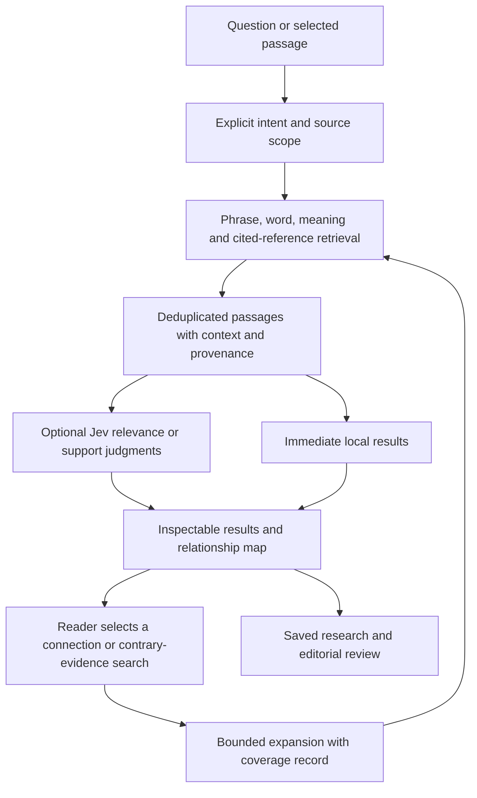

# Find audit and Jev relevance experiment

Find is a promising place to use Jev **after retrieval**, but its immediate problems are navigation, source fidelity, and missing candidates. Repair those first. Then pilot Jev as an optional relevance reranker in the private research workspace. This study does not establish that Jev improves search accuracy.

Audit date: 2026-09-23. Inspected revision: `2d9350a336e841340a0dc4a1acde79464cd149d6`. Scope: the local website preview, hosted source/index files, current search implementation, and official TypeSafe documentation. No public deployment or application-code change was made by this audit. The [evidence bundle](find-feature-audit.json) records query results, source hashes, model responses, questions, usage, and limitations.

The investigation used 30 diagnostic queries, 12 local semantic comparisons, browser reproductions at desktop and phone widths, injected index failures, and 36 live Jev evaluations. These are deliberately selected development examples, not a representative sample of reader behavior. No human relevance adjudication has taken place.

## What Find currently does

Find combines a command palette, a site navigator, a word concordance, a historical topical index, and links to several separate search experiences. It does **not** currently call Jev or run embedding search inside its overlay.

| Layer | Current behavior | Consequence |
| --- | --- | --- |
| Recognized references | Deterministically opens a book, chapter, or verse | Appropriate for “John 3:16”; retain it |
| Site/library matches | Ranks titles, metadata, and destinations in separate groups | A library heading can precede Scripture evidence |
| Quick actions | Substring matching against theme, font, and accessibility keywords | Ordinary text can become a preference-changing command |
| Scripture words | After a 280 ms debounce, counts distinct matching query words; ties follow canonical order | Neither exact-phrase search nor contextual relevance |
| Nave topics | Historical topic titles and a small alias map, with associated references | Useful curated leads, uneven modern vocabulary |
| Search destinations | Links to Scripture, early titles, all editions, early semantic search, and resonance | The user must choose among different scopes and engines |
| Separate Scripture results page | Word results, related topics, and optional local MiniLM meaning search | Semantic retrieval is downstream of Find, not integrated into its ranking |

Find caps its verse suggestions at eight. The word engine keeps up to 200 results; the full page initially shows 40. Word counts in this report mean verses containing at least one retained query token, not phrase occurrences.

Source entry points: [FindOverlay](../../src/app/_components/FindOverlay.tsx), [group assembly](../../src/lib/site/find-query.ts), [text adapter](../../src/lib/site/find-text.ts), [word matcher](../../src/lib/scriptures/search.ts), [related topics](../../src/lib/scriptures/related.ts), and [results page](../../src/app/scriptures/search/SearchRoom.tsx).

## Confirmed problems, in implementation order

### 1. Submission has an unstable meaning

The form opens the currently selected suggestion, which defaults to the first item. That item can change when asynchronous word results arrive.

In isolated Chrome, immediately submitting “Jesus wept” opened the search page; waiting for results opened Matthew 26:75. “Depression” had no word or Nave matches, so its first item was “Search Scripture for depression.” Enter navigated there. This reproduces the reported experience; the saved TypeSafe key is not involved.

**Proposed behavior:** an ordinary text submission starts a search and keeps the query visible. Explicitly selecting a suggestion opens it. Recognized references may retain direct navigation. Enter must behave consistently while suggestions load. Preserve keyboard selection as an explicit choice rather than treating the default highlight as user intent.

### 2. Ordinary queries can execute commands

“Light of the world,” including its quoted form, ranks “Theme: Light” before passages. Browser testing confirmed Enter changes the theme from system to light and closes Find without searching.

The cause is the substring test in [rankActions](../../src/lib/site/find-actions.ts), together with command-group precedence. Require an explicit command prefix or dedicated command mode before a preference-changing action can execute. Jev is unnecessary for this fix.

### 3. The edition shown in a result is lost on navigation

“kjv: charity” returns KJV matches, but its first link omits the reader's translation parameter. Opening it displays 1 Corinthians 8 in the World English Bible. A reader can therefore inspect different wording from the wording that produced the match.

The same URL construction pattern appears in exact, related, and semantic links on the full results page. Preserve the selected edition from result through reader link and context. Related/semantic previews also need an explicit fallback-edition label when a book is unavailable in the requested translation.

The “see all” handoff retains the literal `kjv:` prefix in the query while also adding `trans=kjv`; the full word engine does not parse that prefix. Normalize it once before passing the query onward. The changed-query issue is identified from code; the reader-edition mismatch was browser-reproduced.

### 4. Semantic candidate selection excludes important passages

The local semantic engine scores chapter averages, selects up to 14 books from the top 48 chapters, then ranks verses only in those books.

For **“love your enemies,” both Luke and Matthew are excluded**. The funnel's first three results are Psalm 25:19, Psalm 38:19, and Psalm 139:22. An exhaustive scan of the same existing vectors ranks **Luke 6:27 first**. Matthew 5:44 and Luke 6:35 are also among the omitted full-scan top 20.

This is a retrieval failure in the Scripture verse engine before any Jev judgment. A reranker cannot promote a passage absent from its input.

The browser check adds an important qualification: the separate resonance panel below the meaning results **does find Luke 6:27 through its Sayings of Jesus index**. The verse is not absent from every search engine on the page. Find currently distributes useful answers across independent lists. Reusing that verified passage index in a unified candidate pool is an immediate experiment to try. After word-result deduplication, the displayed meaning list starts with Psalm 139:22; the separate resonance list starts with Luke 6:27.

All 12 diagnostic queries lost at least one full-scan top-20 result through book selection. That is a rank-preservation observation, not a relevance-recall percentage: a high embedding rank does not establish relevance. The earlier [retrieval benchmark](retrieval-benchmark-v1.md) independently documented the same architecture losing John 1:14 on another query.

Compare a complete local scan with a better passage-level candidate index and hybrid retrieval. Measure download, memory, and phone performance before choosing the implementation; this audit does not recommend blindly increasing the book limit.

### 5. “Exact words” does not mean exact phrase or meaning

| Query | Word-overlap matches | Settled first Find item |
| --- | ---: | --- |
| depression | 0 | Search Scripture destination |
| loneliness | 0 | Search Scripture destination |
| anxiety | 7 | Proverbs 12:25 |
| grief | 27 | Polycarp, Philippians XI |
| hope | 175 | 1 Clement XXVII |
| light of the world | 574 | Theme: Light |
| love your enemies | 696 | Judges 5:31 |
| Jesus wept | 1,041 | Matthew 26:75 |
| does God abandon people | 5,645 | Genesis 6:9 |
| kjv: charity | 24 | 1 Corinthians 8:1, without edition in URL |

The tokenizer discards quotation marks. Ranking counts matching words without phrase position or inverse document frequency, and “not” is a stopword. Matthew 26:75 contains both “Jesus” and “wept”; it ties the short John 11:35 passage and wins through book order.

Add genuine phrase matching and a stronger lexical baseline before attributing gains to Jev. Keep the original query, including negation, for contextual evaluation. Do not treat ordinary stopword removal as a support judgment.

Nave's aliases map anxiety to CARE but have no depression or loneliness entries. Its provenance is clearly labeled as 1897, which should remain visible. Modern labels need contextual retrieval; an ancient passage about sorrow should not be presented as identifying a clinical diagnosis.

### 6. A failed search shard can look like absent evidence

An injected HTTP 503 for the WEB “an” shard removed the exact results for “anxiety” without displaying an exact-search failure. [loadShard](../../src/lib/scriptures/client.ts) converts fetch failures into an empty object.

A separate metadata failure displayed an error but also removed the meaning-search button because that section is nested inside successful lexical results. Independent engines should have independent loading/error states. Missing evidence, a partial scan, and an unavailable index must remain distinguishable.

### 7. Semantic scores need clearer limits

The current engine returns its top 40 without a calibrated “no useful match” threshold. The typo “gref” still produces results, including a verse listing animals. On the full results page, semantic deduplication also suppresses any passage in the word engine's entire 200-result slice, even when that verse is not yet displayed.

A raw similarity score is not relevance certainty. Preserve useful matches in one combined list, offer visible spelling help, and test abstention on nonsense and out-of-scope queries. Do not invent a universal score cutoff from these examples.

## What should be retained

The system already provides deterministic references, local word/embedding search, verified embedding artifacts, cancellation support, source links, and useful separation between primary texts, commentary, and catalog records. The browser checks found no page errors or horizontal overflow in the tested Find phone layout.

Keep these properties. Scripture vectors cover 81 books and 38,029 indexed verses, not only the Protestant canon. The early semantic shelf and expanded all-editions library have different coverage. A unified interface must expose corpus, canon/book scope, translation, language, and source role instead of implying that every search scans every hosted text.

## The live Jev experiment

TypeSafe's [reranking cookbook](https://docs.typesafe.ai/cookbooks/rerank_typesafe) describes scoring query/candidate pairs after a fast shortlist. Its demonstration uses Jev 1.12 on legal citations, with the correct source already present in every shortlist. Its reported gains are not evidence of Scripture performance.

This audit tested pinned **jev-1.13.0** on four queries: depression, loneliness, love your enemies, and does God abandon people. An experimental reciprocal-rank fusion combined lexical top 40, up to 12 Nave references, and production semantic top 40, using constant 60. The top eight per query supplied 32 pairs. Four separately marked diagnostic controls brought the total to 36. This fused ranking is not currently implemented in Find.

Each request included one WEB passage, its neighboring context, and two questions:

- **Usefulness:** would this passage materially help investigate the query? Contrary evidence may qualify; mere vocabulary overlap does not.
- **Relationship:** directly relevant, indirectly relevant, unrelated, or insufficient context.

The exact questions and responses are in the evidence bundle. This is a new exploratory search rubric, separate from passage resemblance and claim support.

| Observation | Before the Jev ranking | After ranking the same eight by usefulness |
| --- | --- | --- |
| loneliness | Sirach 31:4 first | Job 19:14 moves from sixth to first |
| depression | Baruch 4:31 first | Job 30:27 moves from fourth to first; Baruch moves last |
| love your enemies | Leviticus 26:7 first | Exodus 23:5 moves from eighth to first |
| does God abandon people | Deuteronomy 7:6 first | Genesis 50:20 moves to first |

The omitted Matthew 5:44 and Luke 6:27 controls received usefulness values of 0.97 and 0.96. They remained absent from the actual shortlist. Genesis 1:1, supplied as a depression negative control, received 0.02.

These are model outputs, not verified relevance labels. Their numbers must not be displayed as probabilities that a theological or historical claim is true. The two questions can also disagree: Judges 5:31 received the “directly relevant” category but only 0.24 usefulness. Do not interchange the Noul value, Choice distribution, and Choice confidence.

The Psalm 71:11 control illustrates a further distinction: it contains opponents claiming God has forsaken someone. It may be relevant to an investigation without supporting that assertion as the narrator's teaching. Relevance, speaker attribution, and support require separate evaluation.

Across all 36 pairs, Jev assigned 6 direct, 23 indirect, and 7 unrelated labels; none were insufficient context. This does not establish a reliable abstention mechanism.

| Operational measure | Observed |
| --- | ---: |
| Requests / successful results | 36 / 36 |
| Concurrent requests | 2 |
| Retries / cache hits | 0 / 0 |
| Input / output tokens | 29,047 / 3,026 |
| Evaluation wall time, excluding retrieval | 7.06 seconds |
| Individual-call p50 / p95, nearest-rank method | 202 ms / 1,664 ms |
| Estimated input-token charge | $0.00122 |

The charge uses the [documented model rate](https://docs.typesafe.ai/models) checked on the audit date: $0.042 per million input tokens, with free output. It is not an invoice. Batch timing and this small sample do not establish end-to-end interactive latency or production reliability.

TypeSafe's [1.13 limitations](https://docs.typesafe.ai/model-jaggedness/jev-1.13) identify difficulties with literal readings, negation, irrelevant context, and adversarial text. Test those explicitly. Jev supplies bounded judgments; free-form explanatory commentary is not the capability being demonstrated here.

## Recommended Find design

A reader entering “depression” should see an actual results surface headed by the query, with passages and surrounding context, their editions, and clear relevance labels. Distinguish analogous experiences such as sorrow or isolation from a modern clinical term. Keep the query and scope editable. Opening a passage should be a deliberate next action.

The processing order should be:

1. **Resolve explicit intent in code:** reference, command, or text search. Protect exact reference and phrase matches.
2. **Retrieve locally:** phrase/weighted-word search, verified embeddings (including the existing Sayings of Jesus passage index), and labeled historical topic references. Search all eligible sources or disclose partial coverage.
3. **Fuse and deduplicate:** retain provenance, context windows, exact offsets, language, edition, and source role. Group duplicate source passages without silently merging different editions.
4. **Optionally evaluate a bounded shortlist with Jev:** initially 20 candidates; compare 20 versus 30 on development data. One passage/context unit per request, related questions together.
5. **Present grounded results:** original passages, source links, context, and typed relevance labels. Offer a separate “check this claim” action when the reader supplies an explicit proposition.

Reciprocal-rank fusion combines list positions rather than mixing incompatible raw scores; [Microsoft's explanation](https://learn.microsoft.com/en-us/azure/search/hybrid-search-ranking) describes this pattern. Its usefulness for this corpus still needs comparison against simpler baselines.

For a selected essay, sermon, or supplied document, use the same source/offset adapters and boundary-aware chunks. A short, bounded document can alternatively use clause selection with an explicit no-match check, as in TypeSafe's [line-by-line search example](https://docs.typesafe.ai/cookbooks/semantic_find). That is a distinct experiment from searching the entire library in one request.

Keep the first integration private and local. Reuse the saved server-side key, source/model/rubric cache, request limits, timeouts, and explicit incomplete states. Do not send every keystroke to TypeSafe. Show usable local results first; run the optional Jev step on submitted queries and identify its data transfer. Failure must preserve the local results and say that reranking was incomplete.

Public rollout would require a server-held credential, bounded access and quotas, cancellation, and clear query/context handling. Neither the browser bundle nor the public static files should receive the saved key. Search results themselves do not create approved claims or public allusions.

## Product direction: an inspectable research workspace

The user's ambition is a substantially more capable research experience. A useful working name is **Find: Evidence Explorer**. This is a proposed product direction, not a claim of a novel invention or a completed capability.

The distinctive experience should connect six capabilities:

| Capability | What the reader does | Required evidence |
| --- | --- | --- |
| Contextual discovery | Searches an idea in ordinary language and refines its sense | Passage windows, exact edition, original wording, visible search scope |
| Relationship exploration | Opens a passage and follows quotation candidates, paraphrases, or shared themes | Typed edges with both endpoints and context; candidate/review status |
| Testing a claim | Supplies a proposition and asks for supporting, challenging, or inconclusive evidence | Separate support rubric, speaker attribution, preserved mixed evidence |
| Comparing readings | Inspects the same selected passage across available editions | Exact edition text and source locations; no inference of doctrinal agreement |
| Seeing coverage | Inspects which sources and sections were scanned, omitted, or unavailable | Retrieval manifest and explicit budget/stop conditions |
| Continuing research | Saves a query, selected passages, decisions, and annotations for later replay | Source hashes, model/rubric versions, filters, timestamps, and approval history |

For “depression,” the interface could expose related senses such as sorrow, isolation, or hopelessness as editable search refinements. These would be retrieval aids, not diagnoses or a rewritten user claim. A result card would show the source passage with neighboring verses and its edition. “Explore connections” would then open a small map centered on that passage; “Test a claim” would accept the reader's own proposition.

Every map edge needs an inspectable basis. Start with explicit citations, document structure, and reviewed relationships; add model-suggested relationships with visible candidate status. Sharing a theme does not create an influence edge. If passage A resembles B and B resembles C, the interface must not imply that A influenced C. Store each pairwise judgment separately.

A bounded expansion step can search around a selected result or an unresolved question, and then evaluate the new candidates. Record what triggered expansion and stop at an explicit request/source budget. If the user asks for contrary evidence, keep their proposition and corpus scope fixed rather than substituting an easier claim. This provides useful exploration without describing a partial search as exhaustive.

The initial list should remain fast and accessible, with the evidence map as an optional view. “Why shown” should expose concrete retrieval evidence—matched wording, source reference, retrieval channel, and a separately labeled model judgment. It should not manufacture a free-form explanation of the model's internal reasoning.

Three research directions are worth controlled comparison:

- **Context-enriched retrieval.** Anthropic's [contextual retrieval](https://www.anthropic.com/engineering/contextual-retrieval) adds chunk-specific context before embedding and lexical indexing. For this library, first test source-derived headings, neighboring passages, edition, and known speaker metadata; unknown attribution stays unknown. This adaptation is an experiment, not the same implementation as Anthropic's generated context. Keep index-only contextual fields separate from quoted source text.
- **Token-level matching.** [ColBERT](https://github.com/stanford-futuredata/ColBERT) retains finer-grained token representations for query/passage matching. It is a candidate comparison against the current single-vector model, subject to measured index size and local runtime requirements. The March 2026 [ColBERT-Att preprint](https://arxiv.org/abs/2603.25248) explores attention-weighted late interaction; it is a research lead, not a validated dependency choice for this site.
- **Guided graph exploration.** Microsoft's [DRIFT search](https://microsoft.github.io/graphrag/query/drift_search/) combines broader community information with detailed follow-up retrieval. The useful inspiration here is controlled expansion between overview and passage evidence. Adopting its generated graph summaries would add a separate model pipeline and validation problem. Start with verified citations and source structure, and benchmark the value of each expansion.

None of these external methods has been evaluated on this corpus by this audit. Keep a simple hybrid baseline and compare each addition independently. The research question is whether readers find more relevant, contextualized evidence and can verify it with less effort—not whether the system contains the most models.

After the three initial delivery units below, prototype the evidence map and bounded exploration using already verified results. Measure successful source-finding tasks, time to inspect context, attribution/edition errors, and reviewer agreement alongside ranking metrics. This extends the product ambition without silently adding public uploads, generated commentary, or theological-tradition comparison to the first release.

## Evaluation before adopting the new ranking

The existing 200-case relationship/support plan remains necessary for those tasks, but it is not a search benchmark.

Build a separate initial set of **100 human-reviewed search queries**, balanced across reference/quotation lookup, emotional or thematic topics, paraphrases, questions with competing or contrary evidence, and difficult/no-answer queries. Include Scripture, early writings, and supplied general text within those groups. English first; do not infer non-English validation.

Two reviewers should label pooled passages, including alternatives to a single expected answer, and adjudicate disagreements. Split 50 development and 50 held-out queries by query family and related source passages. Freeze retrieval budgets, rubric, model version, and thresholds before the held-out run. Pool results from all compared systems plus reviewer-nominated sources to reduce baseline bias.

Compare four variants: current system; interaction/lexical fixes; improved hybrid retrieval; the same hybrid shortlist plus Jev. This separates model benefit from repairs to the baseline.

Measure candidate coverage against the adjudicated pool, precision at five, graded nDCG at ten, known-item reciprocal rank, irrelevant-result rate, abstention, scope/edition fidelity, cold/warm latency, memory/downloads, and actual token usage. Report per-query-family counts and paired uncertainty intervals. Candidate coverage is relative to reviewed sources, not proof of exhaustive corpus recall.

Proposed gates to freeze before testing:

- All reference, command-isolation, loading-state, edition-link, and failure-state regression cases pass.
- Hybrid candidate retrieval contains at least 95% of nominated relevant targets within the agreed shortlist; report numerator, denominator, and uncertainty.
- Jev improves held-out nDCG@10 over the identical hybrid pool, with the paired uncertainty interval supporting improvement, and does not reduce precision@5. Otherwise keep the faster hybrid ranking.
- Reviewed high-priority results meet the original 95% observed precision / 20% coverage goal where that rubric applies; search relevance does not substitute for the original relationship/support gate.
- Establish a device-specific latency budget from local measurements before freezing it. The 36-call batch is insufficient to choose a defensible production p95 target.

If labels, coverage, or improvement are insufficient, retain Jev as an explicitly experimental review aid. No search-adoption gate was passed in this audit.

## Delivery proposal and verification record

Ship three separately reviewable units:

1. Stable text submission, explicit command mode, edition-preserving links, and honest failure states.
2. Phrase/lexical improvements, corrected candidate coverage, unified scope-aware results, and a frozen search benchmark.
3. Private optional Jev reranking, measured against that baseline, with approved expansion only after evaluation.

This audit changed documentation/evidence only. The current implementation passed **76 focused tests** across Find query/place, Scripture search, semantic retrieval, and ranking. Browser checks reproduced the eight settled queries, the timing-dependent submission, the translation mismatch, injected shard/metadata failures, the narrow layout, and real browser meaning/resonance search. No live-model call is part of those normal tests.

Local raw probes, screenshots, and API caches remain under ignored `.research/find-audit/`; the committed evidence includes source fingerprints, exact evaluation state, pinned questions/model, and all 36 judgments. Source/index changes or a model/rubric change require a new evaluation. The observations above are a diagnosis and a research direction, not a publication-ready theological finding.
